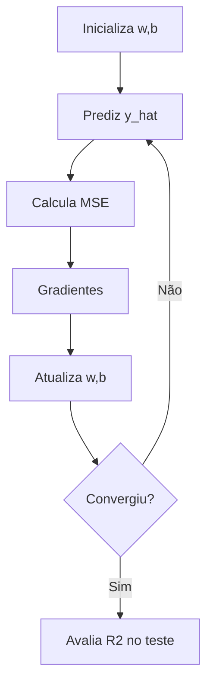

# Regressão Linear do Zero

> Trước khi bạn học, bạn viết gradiente à mão và hiểu vì sao một người giữ được chuyển động.

**Type:** Build
**Languages:** Python
**Prerequisites:** 01-estatistica-descritiva, 02-limpeza-e-eda
**Time:** ~75 minutes

## Mục tiêu học tập

- Dẫn dẫn o gradiente do MSE para `y=wx+b`e thực thi regresão tuyến tính do 0
- Trình độ theo cấp và so sánh với một phương trình bình thường
- Tiêu chuẩn MSE, RMSE và R2 và Tiêu chuẩn quá phù hợp phân chia giữa các phương pháp đào tạo/ kiểm tra
- Estender para regressão múltiple e entender escalação (định hướng để tái lập nhiều lần và hiểu quy mô)

## Vấn đề

Prever price of immovable given tamanho. Sem regressão você cair. Com regressão você aprende um reta que minimiza o erro quadrático. É o "hello mundo" que introduz todo o ciclo de ML: modelo → custo → otimização.

## Khái niệm

Mô hình: `y = wx + b`Custo MSE:`(1/n) sum(y_hat - y)^2`- Tôi không biết.
Gradientes: `dw = (2/n) sum((y_hat-y)x)`- `db = (2/n) sum(y_hat-y)`- Tôi không biết.
Cập nhật: `w -= lr*dw`- Tôi không biết.

Phương trình bình thường: `w = (X^T X)^{-1} X^T y` solução fechada, O(n3) em đặc điểm.

R2 = 1 - SS_res/SS_tot (quanto da variância é explicada).



```figure
linear-regression-fit
```

## Hãy xây dựng nó

- Vâng .`code/main.py``LinearRegression`com `fit`- `predict`- `r2`Bao gồm nhiều lần xem trước Ridge.

## Sử dụng nó

```python
from sklearn.linear_model import LinearRegression
model = LinearRegression().fit(X_train, y_train)
print(model.coef_, model.intercept_, model.score(X_test, y_test))
```

## Chuyển nó

`outputs/skill-regressao.md`Khi sử dụng gradient so với bình thường, khi leo thang, khi điều chỉnh.

## Các bài tập

1. Thực hiện SGD vs GD hàng loạt.
2. Các bài kiểm tra cấp 10 em được đưa ra các hình thành hình thành
3. Thực hiện Ridge (L2).

## Các điều khoản chính

| Term | Significado |
|---|---|
| MSE | Erro quadrático médio |
| R² | Variância explicada |
| Learning rate | Passo do gradiente |
| Scaling | Padronizar para convergir |

## Đọc thêm

- [ISLR cap 3](https://www.statlearning.com/)
- [CS229 notes](https://cs229.stanford.edu/main_notes.pdf)
