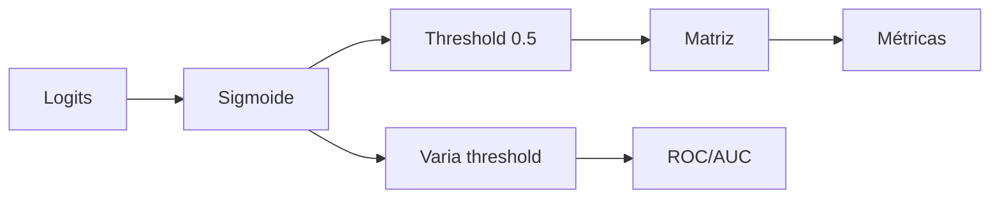

# Classificação e Avaliação

> Accurácia mente em dados desequilibrados  você precisa de precisão, nhớ lại ROC.

**Type:** Build
**Languages:** Python
**Prerequisites:** 03-regressao-do-zero
**Time:** ~70 minutes

## Mục tiêu học tập

- Thực thi regressão logística com sigmoide e entropia cruzada do zero
- Xây dựng matrix confusion e derivar accurácia, chính xác, nhớ lại, F1
- Traçar đường cong ROC và tính toán AUC thủ công
- Chọn ngưỡng tối ưu và giải thích sự chính xác của tradeoff vs. thu hồi

## Vấn đề

Mô hình với 95% độ chính xác có vẻ tối ưu  cho đến khi phát hiện ra rằng 95% các trường hợp là tiêu cực và nó luôn có thể dự đoán tiêu cực.

## Khái niệm

Sigmoid: `σ(z)=1/(1+e^-z)`, mapeia para (0,1).
Custo: BCE = -[y log(p) + (1-y) log(1-p)].
Gradiente: `dw = (1/n) sum((p-y)x)`- Tôi không biết.

Matriz:
```
        Pred 0  Pred 1
Real 0   TN      FP
Real 1   FN      TP
```
Precisão = TP/(TP+FP), Recall = TP/(TP+FN), F1 = 2PR/(P+R.

ROC: biến số ngưỡng 0→1, plota TPR so với FPR. AUC = area sob curve.



```figure
roc-curve
```

## Hãy xây dựng nó

```python
def sigmoid(z): return 1/(1+math.exp(-z))
def bce(y,p): return -(y*math.log(p+1e-15)+(1-y)*math.log(1-p+1e-15))
# treino: p=sigmoid(w*x+b), erro=p-y
```

- Vâng .`code/main.py`hoàn chỉnh.

## Sử dụng nó

```python
from sklearn.linear_model import LogisticRegression
from sklearn.metrics import classification_report, roc_auc_score
model = LogisticRegression().fit(X_train, y_train)
print(classification_report(y_test, model.predict(X_test)))
print(roc_auc_score(y_test, model.predict_proba(X_test)[:,1]))
```

## Chuyển nó

`outputs/skill-avaliacao.md` hướng dẫn métricas per caso de uso.

## Các bài tập

1. Đặt ngưỡng để tối đa hóa F1.
2. Tương tự như sự mất cân bằng 95/5 e so sánh độ chính xác so với F1.
3. Thực hiện CV gấp k.

## Các điều khoản chính

| Term | Definição |
|---|---|
| Precisão | Fração de positivos previstos que são reais |
| Recall | Fração de positivos reais capturados |
| F1 | Média harmônica P/R |
| AUC | Probabilidade de ordenar positivo acima de negativo |

## Đọc thêm

- [Google ML — Classification](https://developers.google.com/machine-learning/crash-course/classification)
- [Sklearn metrics](https://scikit-learn.org/stable/modules/model_evaluation.html)
