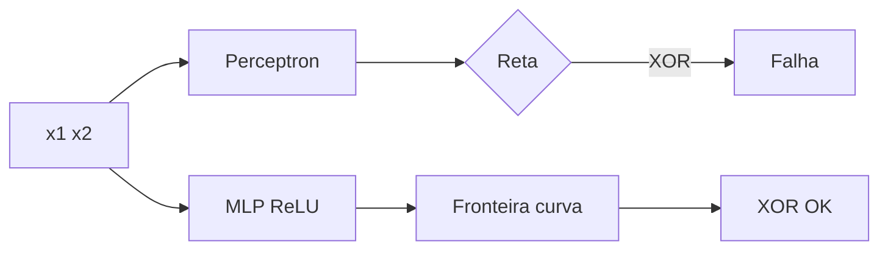

# Perceptron và Deep Learning làm không

> Từ một đường phân chia điểm đến một đường tròn học hỏi tất cả mọi thứ.

**Type:** Build
**Languages:** Python
**Prerequisites:** 03-regressao-do-zero, 04-classificacao-e-avaliacao
**Time:** ~80 minutes

## Mục tiêu học tập

- Thực hiện o nhận thức (rule de Rosenblatt) và chứng minh khi hội tụ/lối
- Estender for MLP com ReLU/sigmoide, hướng dẫn về phía trước và phía sau
- Trình độ học tập theo cấp và so sánh`torch.nn.Linear`
- Khán giả hình ảnh biên giới quyết định và giải thích cho nhận thức về sự cố không có XOR

## Vấn đề

Regressão logística separa com reta. Nhưng dữ liệu trong vòng tròn hay XOR? Uma reta não resolver. Học tập sâu sử dụng các đường tròn (camadas) + không tuyến tính (ReLU) để tạo ra các đường cong biên giới. Nghĩa hoặc nhận thức là hiểu cho sự sâu sắc quan trọng.

## Khái niệm

Perceptron:`y = sign(w·x + b)`, cập nhật: `w += lr*(y_true - y_pred)*x`- Tôi không biết.

giới hạn: chỉ phân biệt theo đường thẳng.

MLP 1 oculta: `h=ReLU(W1 x + b1)`- `y=sigmoid(W2 h + b2)`- Các nguồn gốc của các chuỗi backprop.

ReLU: `max(0,z)` gradiente 1 se z> 0, 0 nếu ngược lại.



```figure
perceptron-vs-mlp
```

## Hãy xây dựng nó

- Vâng .`code/main.py`: perceptron + MLP 2 camadas com backprop numpy.

## Sử dụng nó

```python
import torch
model = torch.nn.Sequential(torch.nn.Linear(2,8), torch.nn.ReLU(), torch.nn.Linear(8,1), torch.nn.Sigmoid())
# treino com torch.optim.SGD
```

MLP không phải có sự đồng bộ với Phytorch em < 5% độ chính xác không có XOR.

## Chuyển nó

`outputs/skill-perceptron.md` khi sử dụng đường thẳng so với MLP, como debugar fronteira.

## Các bài tập

1. Các mô hình không thể nhận thấy tương thích trong XOR (bằng chứng).
2. Tròque ReLU por sigmoide na oculta  o que muda no treino?
3. Thêm thêm 2a camada oculta e meça ganho.

## Các điều khoản chính

| Term | Definição |
|---|---|
| Perceptron | Classificador linear com update erro-dirigido |
| ReLU | max(0,z) |
| Backprop | Regra da cadeia para gradientes |
| XOR | Problema não-linear que exige oculta |

## Đọc thêm

- [Rosenblatt 1958 — Perceptron](https://psycnet.apa.org/record/1959-09865-001)
- [3Blue1Brown — Neural Networks](https://www.3blue1brown.com/topics/neural-networks)
- [PyTorch basics](https://pytorch.org/tutorials/beginner/basics/intro.html)
