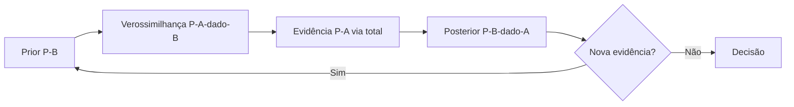

# Probabilidad do Zero: Condicional, Total e Bayes

> O test deu positif  là một cơ hội thực sự của bạn sẽ bị bệnh? Sem Bayes, bạn đã sai 10 lần.

**Type:** Build
**Languages:** Python
**Prerequisites:** 01-estatistica-descritiva
**Time:** ~60 minutes

## Mục tiêu học tập

- Xét nghiệm khả năng điều kiện P(A B) và kiểm tra độc lập với một quy tắc sản phẩm
- Thực hiện một quy định về khả năng tổng thể để phân hủy một sự kiện trong các kịch bản độc quyền
- Thuộc dẫn và áp dụng lý thuyết của Bayes cho điều kiện biến đổi (teste médico, spam, churn)
- Xây dựng một PMF discreta do zero và tính toán hy vọng và sự khác biệt trong các libs

## Vấn đề

Một xét nghiệm bệnh hiếm có có 99% độ nhạy và 95% độ đặc biệt. Một bệnh đạt đến 1 trong mỗi 1000 người.

O instinto diz 99%. A resposta correta é ~2%. O erro  confundir P(positivo dizerdoente) com P(doente dizerpositivo)  se chama falácia da taxa-base, e aparece em churn, fraude, spam e qualquer classificador com classe rara. Sem probabilidade condicional, você interpreta todo modelo errado.

## Khái niệm

### Probabilidad condicional

```
P(A|B) = P(A ∩ B) / P(B),  com P(B) > 0
```

"Probability of A given that B happened" (sự xác suất của A cho rằng B đã xảy ra) giới hạn vũ trụ cho các trường hợp mà B xảy ra.

Ví dụ: dado justo, B = "saiu par" {2,4,6}, A = "saiu 6". P(A

### Independência

A e B são independentes se o conhecimento de B não muda a chance de A:

```
P(A|B) = P(A)  <=>  P(A ∩ B) = P(A) · P(B)
```

2 bản phát hành: P {\\displaystyle P} không 2o {\\displaystyle P} không 1o {\\displaystyle P} = 1/2 = P} không 1o {\\displaystyle P} = 1/2 = P} không 2o {\\displaystyle P} = 1/2 = P} không 2o {\\displaystyle P} = 1o {\\displaystyle P} = 1o {\\displaystyle P} = 1o {\\displaystyle P} = 1o}

### Lei da probabilidade tổng số

Se B1..Bn particionam o espaço (mutuamente exclusivos, cobrem tudo):

```
P(A) = Σ P(A|Bi) · P(Bi)
```

(Bản dịch vụ: P positivo) = P positivo de fazer saudável)

### Tiến thuyết de Bayes

Inverte a conditional combinando như hai công thức trên:

```
P(B|A) = P(A|B) · P(B) / P(A)
```

test médico: P(Noente de la positividad) = 0,99·0,001 / (0,99·0,001 + 0,05·0,999) ≈ 0,0194 ≈ 2%.



```figure
stats-probability-bayes
```

## Hãy xây dựng nó

### Bước 1: Condicional e independência do zero

```python
def cond_prob(p_ab, p_b):
    if p_b <= 0:
        raise ValueError("P(B) deve ser > 0")
    return p_ab / p_b

def joint_if_independent(p_a, p_b):
    return p_a * p_b

def is_independent(p_a, p_b, p_ab, tol=1e-9):
    return abs(p_ab - p_a * p_b) <= tol

print(cond_prob(1/6, 3/6))          # 0.333: P(6 | par)
print(is_independent(0.5, 0.5, 0.25))  # True: duas moedas
```

### Bước 2: Tổng khả năng

```python
def total_prob(cond_probs, priors):
    # cond_probs[i] = P(A|Bi), priors[i] = P(Bi)
    if abs(sum(priors) - 1.0) > 1e-9:
        raise ValueError("priors devem somar 1")
    return sum(c * p for c, p in zip(cond_probs, priors))

p_pos = total_prob([0.99, 0.05], [0.001, 0.999])
print(f"P(positivo) = {p_pos:.4f}")  # ~0.0509
```

### Bước 3: Bayes + PMF, esperança e variância

```python
def bayes(p_a_given_b, p_b, p_a):
    return p_a_given_b * p_b / p_a

print(f"P(doente|+) = {bayes(0.99, 0.001, p_pos):.4f}")  # ~0.0194

def pmf(values, probs):
    if abs(sum(probs) - 1.0) > 1e-9:
        raise ValueError("probs devem somar 1")
    return dict(zip(values, probs))

def expected_value(d):
    return sum(x * p for x, p in d.items())

def variance_dist(d):
    mu = expected_value(d)
    return sum(((x - mu) ** 2) * p for x, p in d.items())

dado = pmf([1,2,3,4,5,6], [1/6]*6)
print(expected_value(dado), variance_dist(dado))  # 3.5, ~2.917
```

## Sử dụng nó

O mesmo cálculo com`fractions`(exato) ou contagem empírica:

```python
from fractions import Fraction

# Bayes exato com frações
p = Fraction(99,100) * Fraction(1,1000) / (
    Fraction(99,100)*Fraction(1,1000) + Fraction(5,100)*Fraction(999,1000))
print(p, float(p))  # ~0.0194

# Verificação empírica por simulação (lei dos grandes números)
import random
random.seed(0)
n = 200_000
doente_pos = sum(1 for _ in range(n)
                 if random.random() < 0.001 and random.random() < 0.99)
saud_pos = sum(1 for _ in range(n)
               if random.random() >= 0.001 and random.random() < 0.05)
print(doente_pos / (doente_pos + saud_pos))  # ~0.02
```

Các mô phỏng và công thức phải phù hợp với 2a casa decimal com n grande.

## Chuyển nó

Artefato: `outputs/skill-probabilidade.md` danh sách kiểm tra "bất cứ khi nào điều kiện thay đổi, tuyên bố trước, thực sự giống như và bằng chứng trước khi kết thúc".

## Các bài tập

1. Một bộ lọc spam đánh dấu 98% spam và 2% không spam. Nếu 30% email là spam, thì spam là gì?`bayes()`- Tôi không biết.
2. Bằng chứng với mã rằng P  A  B) = P  B  A) chỉ có giá trị khi P  A) = P  B. Đưa một số tiền.
3. Xây dựng một PMF của "soma de dois dados" và tính toán hy vọng và sự khác nhau`expected_value()`e `variance_dist()`- Tôi không biết.

## Các điều khoản chính

| Term | O que dizem | O que realmente é |
|---|---|---|
| Condicional P(A\|B) | "chance de A se B" | P(A∩B)/P(B); restringe o universo a B |
| Independência | "sem relação" | P(A∩B)=P(A)·P(B); saber B não muda A |
| Probabilidade total | "média ponderada" | P(A)=Σ P(A\|Bi)·P(Bi) sobre partição |
| Teorema de Bayes | "inverter a pergunta" | P(B\|A)=P(A\|B)·P(B)/P(A) |
| PMF | "tabela de chances" | P(X=x) para cada valor discreto; soma 1 |
| Esperança | "média teórica" | Σ x·P(x); para onde a média amostral converge |

## Đọc thêm

- [Seeing Theory — Probability](https://seeing-theory.brown.edu/) visual interativo
- [Stat Trek: Bayes Theorem](https://stattrek.com/probability/bayes-theorem) Reference com examples
- [Python `fractions` docs](https://docs.python.org/3/library/fractions.html) cálculo exato para produção
