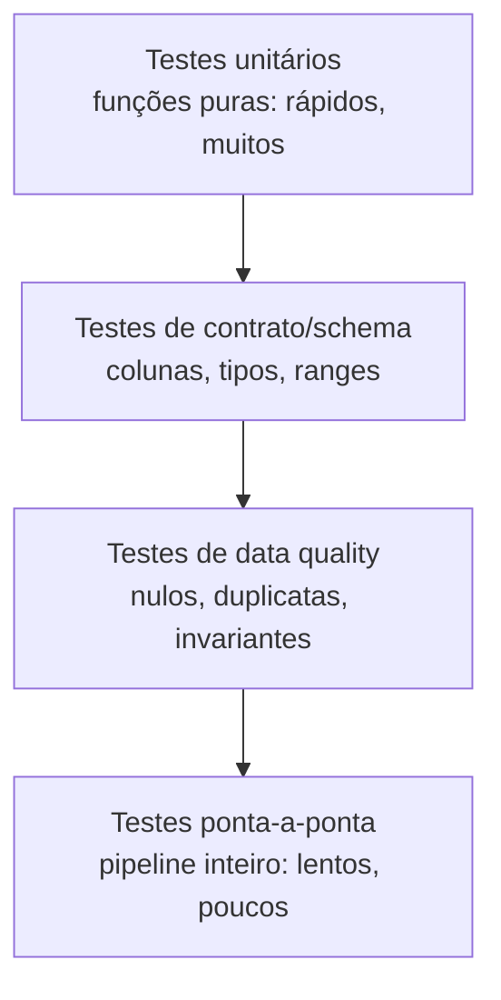

# Mã sạch và kiểm tra cho khoa học dữ liệu

> O notebook roda na sua máquina e quebra em produção  học một biến đổi phân tích khám phá em ống dẫn thử nghiệm.

**Type:** Build
**Languages:** Python
**Prerequisites:** 01-estatistica-descritiva, 02-limpeza-e-eda
**Time:** ~60 minutes

## Mục tiêu học tập

- Giải thích cho những cuốn sổ cái mà bạn có thể làm trong sản xuất (estado oculto, execução fora de ordem, dependências implícitas)
- Refactorar un notebook monolítico em pipeline modular com funções puras e contratos de esquema
- Thực hiện SRP, DRY và xác nhận các mã dữ liệu của hội đồng
- Escrever test de qualité des données (chế hoạch, nulos, phạm vi, không biến)
- Nghĩa giải một phép thuật của testes áp dụng bằng một DS: unitários rápidos, contrato/schema, ponta-a-ponta lentos

## Vấn đề

Bạn giao một sổ ghi chép chạy hoàn hảo trên máy của bạn. Bạn đồng nghiệp thực hiện "Run All" và qubra trên tế bào 7: một biến thể đã được ghi lại trên tế bào 12 được thực hiện để theo trật tự, một cột `idade`Come Como string `"32"`Em vez de int, e um `dropna()`Trong sản xuất, một công việc theo lịch trình xảy ra vào nửa đêm như một tin nhắn hữu ích.

Các sổ tay có tính toán tối ưu hóa, không lặp lại. Estado global mutável, células executadas fora de orden e tipos implícitos tornam o resultado não-determinístico. O custo aparece depois: retrabalho, modelo treinado com dados corrompidos, decisão errada. A saída é tratar código de dados como software: funções pequenas, entradas validadas, comportamento testado.

## Khái niệm

### Funções puras: cùng một lối vào, cùng một lối ra

Uma função pura não lê nem escreve global, não depende da ordem de execução:

```python
# impuro: depende de global e muta o argumento
THRESHOLD = 18
def filtrar_adultos(rows):
    return [r for r in rows if r["idade"] >= THRESHOLD]  # quebra se idade for str

# puro: dependências explícitas, sem mutação
def filtrar_adultos(rows, idade_minima=18):
    return [{**r} for r in rows if int(r["idade"]) >= idade_minima]
```

Quy tắc thực hành: um verbo por função (`load`- `validate`- `clean`- `featurize`), I/O no meio do pipeline (I/O só nas bordas), trở lại novo em vez de mutar.

### SOLID em version DS (chỉ cần quan tâm ở đây)

- **S — Single Responsibility:** `validate_schema()`Valid, `clean()`Limpa, chúng ta không bao giờ được ở bên nhau.
- **D — Dependency Inversion (na prática):**một giai đoạn nhận được o que precisa por paramétro (giới hạn, cột), không quan trọng toàn cầu.
- **Contrato na borda:**Valid o schema logo na entrada (colunas presentes, tipos convertibles).

### Pyrâmide de testes pour dados



Một cơ sở (unitarios + schema) quay trong giây mỗi lần tham gia. hoặc top (pipeline inteiro com dados reais) quay không có CI/noturno.

```figure
clean-code-pipeline-overview
```

## Hãy xây dựng nó

### Bước 1: Tạo ra một bảng như danh sách các quy định và xác nhận kế hoạch

Sem pandas: cada linha é um `dict`, một bảng là một`list[dict]`- Tôi không biết.

```python
SCHEMA = {
    "nome": str,
    "idade": int,   # aceita "32" conversível
    "salario": float,
}

def validate_schema(rows, schema):
    errors = []
    for i, row in enumerate(rows):
        for col, tipo in schema.items():
            if col not in row:
                errors.append(f"linha {i}: coluna ausente '{col}'")
                continue
            try:
                tipo(row[col])
            except (ValueError, TypeError):
                errors.append(f"linha {i}: '{col}'={row[col]!r} não converte para {tipo.__name__}")
    return errors
```

### Bước 2: Các công cụ đơn giản của đường ống

```python
def clean_rows(rows):
    out = []
    for r in rows:
        novo = {"nome": str(r["nome"]).strip(), "idade": int(r["idade"]), "salario": float(r["salario"])}
        if novo["idade"] >= 0 and novo["salario"] >= 0:
            out.append(novo)
    return out

def featurize(rows):
    return [{**r, "adulto": r["idade"] >= 18} for r in rows]

def run_pipeline(rows):
    errors = validate_schema(rows, SCHEMA)
    if errors:
        raise ValueError("schema inválido:\n" + "\n".join(errors[:5]))
    return featurize(clean_rows(rows))
```

### Bước 3: Kiểm tra chất lượng dữ liệu

```python
def check_quality(rows):
    checks = {
        "sem_nulos": all(v is not None and v != "" for r in rows for v in r.values()),
        "idades_validas": all(0 <= r["idade"] <= 120 for r in rows),
        "sem_duplicatas": len({(r["nome"], r["idade"]) for r in rows}) == len(rows),
    }
    return checks
```

Mỗi kiểm tra trả lại tên gọi booleano: khi lỗi, bạn biết chính xác bất biến nào đã xảy ra.

## Sử dụng nó

O mesmo padrão com a biblioteca de produção (`pandera`Para-chế hoạch,`pytest`Como runner:

```python
# import pandera.pandas as pa
# import pandas as pd
# from pandera import Column, DataFrameSchema, Check
#
# schema = DataFrameSchema({
#     "nome": Column(str),
#     "idade": Column(int, Check.between(0, 120)),
#     "salario": Column(float, Check.ge(0)),
# })
# df = pd.DataFrame([{"nome": "ana", "idade": 30, "salario": 5000.0}])
# print(schema.validate(df))
# # pytest: mesmos asserts do unittest, com fixtures e mensagens melhores
```

Seu validador stdlib e `pandera`phải đồng nhất: linha válida passa nos dois, linha inválida falha nos dois.

## Chuyển nó

Artefato: `outputs/skill-clean-code-ds.md` checklist for converter any notebook em pipeline: "funções puras, schema na board, quality checks nomeados, tests rápidos embaixo e ponta-a-ponta em cima".

## Các bài tập

1. Quebre propositalmente: passe `idade="trinta"`E uma linha sem `salario`Một tin nhắn sai lầm trên dòng thư?
2. Chuyện này là một kiểm tra.`salario_mediano_positivo`Một thử nghiệm sai khi tất cả các mức lương là 0. Vì sao các biến đổi kinh doanh có giá trị hơn một thử nghiệm loại?
3. Convert a function sua que muta global em função pura (chỉ lệ rõ ràng, trở lại mới).

## Các điều khoản chính

| Term | O que dizem | O que realmente é |
|---|---|---|
| Função pura | "função limpa" | Mesma entrada -> mesma saída, sem global nem mutação; testável em isolamento |
| Schema | "formato dos dados" | Contrato de colunas + tipos; validado na borda, falha rápido |
| Data quality check | "teste de dados" | Invariante nomeado (nulos, ranges, duplicatas) que explica o que quebrou |
| SRP | "uma coisa só" | Cada função/etapa tem um único motivo para mudar |
| Pirâmide de testes | "testar tudo" | Muitos testes rápidos na base (unit/schema), poucos lentos no topo (e2e) |
| Falhe rápido | "validar cedo" | Erro na entrada com mensagem útil em vez de corrupção silenciosa adiante |

## Đọc thêm

- [PEP 8 — Style Guide](https://peps.python.org/pep-0008/) hội nghị chính thức
- [unittest docs](https://docs.python.org/3/library/unittest.html) runner stdlib
- [Pandera docs](https://pandera.readthedocs.io/) validation de schéma em production
