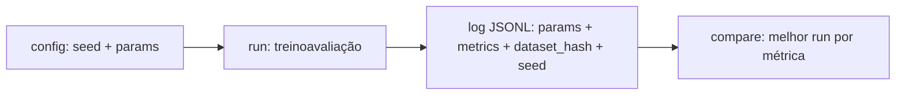

# Reprodutibilidad e Tracking de Experimentos

> "Funcionou ayer" không phải là kết quả khoa học  học được một số hạt giống, các bộ dữ liệu phiên bản và đăng ký mỗi lần chạy.

**Type:** Build
**Languages:** Python
**Prerequisites:** 01-estatistica-descritiva, 08-clean-code-testes-ds
**Time:** ~60 minutes

## Mục tiêu học tập

- Giải thích như ba nguồn của non-determinismo: hạt giống không cố định, bộ dữ liệu sem version, hyperparâmetros não registrados
- Hạt cố định`random`(e `numpy`- Không.`torch`không sử dụng nó) để lặp lại chia e amostragens
- Phiên bản của một tập dữ liệu có hash SHA-256 do conteúdo canônico
- Registrar chạy (params + metrics + dataset_hash) em JSONL com stdlib
- So sánh chạy e escolher o melhor por métrica com função pura

## Vấn đề

Bạn đã quay xe hoặc đào tạo hai lần và nhận được độ chính xác 0.87 và 0.83 không thay đổi gì.

Không có hạt giống cố định, mỗi mixer / chia / amostragem muda. Không có bộ dữ liệu, bạn không biết trong những gì đã được đào tạo. Không có log de param / metrics, không có cách so sánh hoặc kiểm toán.

## Khái niệm

### Hạt: o ponto de partida do aleatório

Geradores pseudo-aleatórios são determinísticos dada một hạt giống:

```python
import random
random.seed(42)
print(random.random())  # sempre 0.6394267984578837
```

Đặt một hạt giống khi không bắt đầu (`set_seed(42)`Các hạt khác nhau = các thí nghiệm khác nhau; vì vậy một hạt cũng là một param được đăng ký.

### Verão de dataset = hash do conteúdo

Nome de arquivo mente (`dados_final_v2_REAL.csv`). Không có:

```
versão = sha256(representação_canônica_das_linhas)
```

Hai bảng có cùng nội dung, một byte.

### Tracker minimalista: uma linha JSON mỗi chạy



Mỗi lần chạy đăng ký`timestamp`- `seed`- `dataset_hash`- `params`- `metrics`.O archivo JSONL é appendi-only: histórico immutable, legible by any tool.

```figure
reproducibility-tracking-overview
```

## Hãy xây dựng nó

### Bước 1: Đặt một hạt giống và mặt chia xác định

```python
import random

def set_seed(seed):
    random.seed(seed)

def train_test_split(rows, test_ratio=0.2, seed=42):
    rng = random.Random(seed)  # instância local: não polui o global
    idx = list(range(len(rows)))
    rng.shuffle(idx)
    k = int(len(rows) * (1 - test_ratio))
    return [rows[i] for i in idx[:k]], [rows[i] for i in idx[k:]]
```

Mkpụrụ mesma + mesmos dados = mesmo chia, luôn luôn.

### Bước 2: Hash canônico do dataset

```python
import hashlib, json

def dataset_hash(rows):
    canon = json.dumps(rows, sort_keys=True, ensure_ascii=False)
    return hashlib.sha256(canon.encode("utf-8")).hexdigest()[:12]
```

`sort_keys=True`garante orden canônica das chaves; o prefixo de 12 chars basta como versão legible.

### Bước 3: Tracker JSONL

```python
import json, datetime

def log_run(path, params, metrics, seed, dhash):
    record = {
        "timestamp": datetime.datetime.now(datetime.timezone.utc).isoformat(),
        "seed": seed, "dataset_hash": dhash,
        "params": params, "metrics": metrics,
    }
    with open(path, "a", encoding="utf-8") as f:
        f.write(json.dumps(record, ensure_ascii=False) + "\n")
    return record

def load_runs(path):
    with open(path, encoding="utf-8") as f:
        return [json.loads(line) for line in f if line.strip()]

def best_run(runs, metric="accuracy", higher=True):
    return (max if higher else min)(runs, key=lambda r: r["metrics"][metric])
```

## Sử dụng nó

O mesmo com a stack de producción (`mlflow`Citado, `numpy`Para hạt):

```python
# import mlflow, numpy as np
#
# np.random.seed(42)  # além de random.seed(42)
# # import torch; torch.manual_seed(42)
#
# # mlflow.start_run()
# # mlflow.log_params({"lr": 0.01, "seed": 42, "dataset_hash": "abc..."})
# # mlflow.log_metric("accuracy", 0.87)
# # mlflow.end_run()
```

Các trình theo dõi JSONL e o mlflow registram o mesmo contrato: params + metrics + dataset_hash + seed.

## Chuyển nó

Artefato: `outputs/skill-reprodutibilidade-tracking.md` checklist de todo experimento: "trái được cố định và đăng ký, bộ dữ liệu có hash, một JSON mỗi chạy, chạy tốt nhất được chọn cho chức năng thuần túy".

## Các bài tập

1. Đường `train_test_split`Hai lần với hạt giống 42 và một hạt giống 7.
2. Tôi thay đổi một tập dữ liệu và tính toán lại hash.`sort_keys=True`quan trọng?
3. Logue 3 chạy thay đổi một param, sau khi sử dụng `best_run`com `higher=False`Một cái tên sai lầm.

## Các điều khoản chính

| Term | O que dizem | O que realmente é |
|---|---|---|
| Seed | "número mágico" | Estado inicial do gerador pseudo-aleatório; fixa toda a sequência sorteada |
| Dataset hash | "versão dos dados" | SHA-256 do conteúdo canônico; prova em quais dados você treinou |
| Run | "um treino" | Uma execução com seed + params + dataset fixos e métricas registradas |
| JSONL | "log de runs" | Um objeto JSON por linha, append-only; histórico auditável |
| Tracking | "acompanhar modelo" | Registrar params/metrics/versões para comparar e reproduzir |
| Determinismo | "sempre igual" | Mesma seed + mesmos dados + mesmo código = mesmo resultado |

## Đọc thêm

- [MLflow Tracking docs](https://mlflow.org/docs/latest/tracking.html) sản xuất
- [hashlib docs](https://docs.python.org/3/library/hashlib.html) Reference stdlib
- [NumPy random seed docs](https://numpy.org/doc/stable/reference/random/index.html) hạt giống em sản xuất
