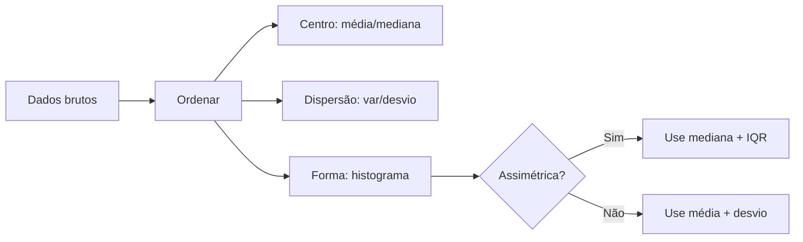

# 统计描述:零

> 媒体,中介和变异讲述了一个故事,一个表格隐藏了一个外来的达.

**Type:** Build
**Languages:** Python
**Prerequisites:** None
**Time:** ~60 minutes

## 学习目标

- 计算媒体,中位数,模式,变量,生活方式和四分之一使用只不过
- 建立一个历史图表和一个文字/ASCII前使用一个图案
- 检测与IQR和z-score的异常值,并解释每次出现错误
- 与正常的解释和短语相比

## 问题

你得到一个CSV和1万个工资.$ 8.500, mas 70% das pessoas ganham menos que isso. Por quê? Um único CEO com R$如果你只报道媒体,你就想.

在数据科学中,数据总结是一个标准,但它是最常见的错误和最昂贵的.

## 概念

### 中央:媒体vs中介与时尚

```
dados = [2, 3, 3, 5, 500]
média   = (2+3+3+5+500)/5 = 102.6  <- sensível a outlier
mediana = valor do meio ordenado = 3  <- robusta
moda    = valor mais frequente = 3
```

规则:分布相对 -> 媒体 ~= 平均水平.

### 传播:变化和转变

```
variância = média((x - média)^2)
desvio    = sqrt(variância)
```

对于比较小组,使用的方法是:

### 石和IQR (强)

排序:Q1=百分点25个,Q2=中位数,Q3=百分点75个.
智能指数=Q3 -Q1 (50%的中心度幅).

杜凯法规的异常标准:
```
limite_inf = Q1 - 1.5*IQR
limite_sup = Q3 + 1.5*IQR
```

### 分 (参数)

```
z = (x - média) / desvio
```
|z| > 3 = candidato a outlier, mas assume distribuição ~normal. Em dados assimétricos, IQR é melhor.



```figure
stats-descriptive-overview
```

## 建立它

### 步骤1:统计中心和零分散

```python
import math

def mean(data):
    return sum(data) / len(data)

def median(data):
    s = sorted(data)
    n = len(s)
    mid = n // 2
    return s[mid] if n % 2 == 1 else (s[mid-1] + s[mid]) / 2

def variance(data, sample=False):
    m = mean(data)
    div = len(data) - 1 if sample else len(data)
    return sum((x - m)**2 for x in data) / div

def std(data, sample=False):
    return math.sqrt(variance(data, sample))

def mode(data):
    freq = {}
    for x in data:
        freq[x] = freq.get(x, 0) + 1
    return max(freq, key=freq.get)

data = [2, 3, 3, 5, 500]
print(f"média={mean(data):.1f} mediana={median(data)} moda={mode(data)} std={std(data):.1f}")
```

### 步骤2:四分之一的IQR

```python
def percentile(data, p):
    s = sorted(data)
    k = (len(s)-1) * p / 100
    f = math.floor(k)
    c = math.ceil(k)
    if f == c:
        return s[int(k)]
    return s[f] * (c - k) + s[c] * (k - f)

def quartiles(data):
    return percentile(data, 25), percentile(data, 50), percentile(data, 75)

def iqr(data):
    q1, _, q3 = quartiles(data)
    return q3 - q1

q1, q2, q3 = quartiles([1,2,3,4,5,6,7,8,9,100])
print(f"Q1={q1} Q2={q2} Q3={q3} IQR={iqr([1,2,3,4,5,6,7,8,9,100])}")
# outlier: 100 > Q3+1.5*IQR ?
```

### 步骤3: 史蒂斯图拉 ASCII

```python
def histogram(data, bins=5):
    lo, hi = min(data), max(data)
    width = (hi - lo) / bins
    counts = [0]*bins
    for x in data:
        idx = min(int((x - lo) / width), bins-1) if width else 0
        counts[idx] += 1
    for i, c in enumerate(counts):
        bar = "#" * c
        print(f"{lo + i*width:6.1f} | {bar} ({c})")

histogram([1,1,2,2,2,3,3,5,8,9], bins=4)
```

## 用它

算数与`numpy`现在,我们要去.`statistics`其他:

```python
import statistics
import numpy as np

data = [2, 3, 3, 5, 500]
print(statistics.mean(data), statistics.median(data), statistics.stdev(data))
print(np.mean(data), np.median(data), np.std(data, ddof=0))
print(np.percentile(data, [25,50,75]))
# histograma real
# import matplotlib.pyplot as plt
# plt.hist(data, bins=10); plt.show()
```

您的代码是零和零的,必须以二号的数分数.

## 运送它

艺术品:`outputs/skill-estatistica-descritiva.md`所有EED的检查列表: "前训练,报道媒体/中介,发展/IQR,历史表和%的异常值".

## 运动

1. 千千个示范`exp(λ=1)`对于媒体和媒体的比较,我们有什么不同?
2. 实现对称 (skew) = E[(x-média) ^3]/desvio^3 sem libs.
3. 换一个规则 IQR 1.5 对于 3.0. 你失去了多少个异常值?

## 关键词

| Term | O que dizem | O que realmente é |
|---|---|---|
| Média | "valor típico" | Soma/n, sensível a outliers; só típica se distribuição simétrica |
| Mediana | "meio dos dados" | Valor que corta 50% abaixo/acima; robusta |
| Desvio-padrão | "erro médio" | Raiz da variância; distância típica até a média |
| IQR | "caixa do boxplot" | Q3-Q1; amplitude dos 50% centrais |
| Z-score | "quantos desvios" | (x-média)/desvio; assume normalidade |
| Outlier | "ponto estranho" | Observação além de Q3+1.5*IQR ou |z|>3 |

## 进一步阅读

- [Seeing Theory — Descriptive Stats](https://seeing-theory.brown.edu/)视觉互动
- [NIST Engineering Statistics Handbook](https://www.itl.nist.gov/div898/handbook/)参考
- [SciPy stats docs](https://docs.scipy.org/doc/scipy/reference/stats.html)生产
