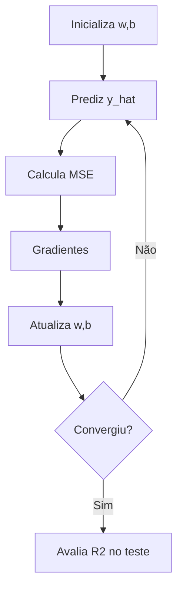

# 归归线性零

> 在学习之前,你必须写一个手动的梯度,

**Type:** Build
**Languages:** Python
**Prerequisites:** 01-estatistica-descritiva, 02-limpeza-e-eda
**Time:** ~75 minutes

## 学习目标

- 导向或转变的MSE`y=wx+b`实现的直线回归是零
- 随着下降梯度和平衡与正常等式的比较
- 诊断过度配备的标准
- 复制复制的标准,理解扩展

## 问题

随着回归,你学会了减少或四分之一的错误的 reta.

## 概念

模型:`y = wx + b`卡斯托·MSE:`(1/n) sum(y_hat - y)^2`现在,我们要去.
级:`dw = (2/n) sum((y_hat-y)x)`现在`db = (2/n) sum(y_hat-y)`现在,我们要去.
更新:`w -= lr*dw`现在,我们要去.

常态方程:`w = (X^T X)^{-1} X^T y` solução fechada, O(n3) em 功能.

数: 数: 数: 数: 数: 数: 数: 数: 数: 数:



```figure
linear-regression-fit
```

## 建立它

查看`code/main.py`其他`LinearRegression`公司`fit`现在`predict`现在`r2`包含多个"山"预览.

## 用它

```python
from sklearn.linear_model import LinearRegression
model = LinearRegression().fit(X_train, y_train)
print(model.coef_, model.intercept_, model.score(X_test, y_test))
```

## 运送它

`outputs/skill-regressao.md`当使用梯度与正常时,当升级时,当调整时.

## 运动

1. 实施 SGD与批量GD.
2. 测试10级的四分之一的测试
3. 实现 (L2)

## 关键词

| Term | Significado |
|---|---|
| MSE | Erro quadrático médio |
| R² | Variância explicada |
| Learning rate | Passo do gradiente |
| Scaling | Padronizar para convergir |

## 进一步阅读

- [ISLR cap 3](https://www.statlearning.com/)
- [CS229 notes](https://cs229.stanford.edu/main_notes.pdf)
