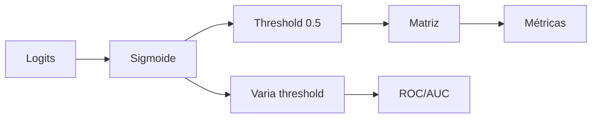

# 类别和评估

> 精确的数据不平衡, 您需要精确的数据, 提醒 ROC.

**Type:** Build
**Languages:** Python
**Prerequisites:** 03-regressao-do-zero
**Time:** ~70 minutes

## 学习目标

- 实现后勤回归与零的进化
- 构建混矩阵,并导出精度,精度,回忆,F1
- 随着ROC的曲线,手动计算AUC
- 选择最好的门,解释交易精度与召回

## 问题

模型 95% 的准确性似乎是最佳的,直到发现 95% 的病例是负面的,并且总是被预防的.

## 概念

化物`σ(z)=1/(1+e^-z)`果,果,果,果,果,果,果,果,果,果,果,果,果,果,果,果,果,果,果,果,果,果,果,果,果,果,果,果,果
: BCE = -[y log(p) + (1-y) log(1-p)].
级:`dw = (1/n) sum((p-y)x)`现在,我们要去.

马特里斯:
```
        Pred 0  Pred 1
Real 0   TN      FP
Real 1   FN      TP
```
确 = TP/(TP+FP),回忆 = TP/(TP+FN),F1 = 2PR/(P+R.

率:变量门 0→1,TPR与FPR的波多.



```figure
roc-curve
```

## 建立它

```python
def sigmoid(z): return 1/(1+math.exp(-z))
def bce(y,p): return -(y*math.log(p+1e-15)+(1-y)*math.log(1-p+1e-15))
# treino: p=sigmoid(w*x+b), erro=p-y
```

查看`code/main.py`完全的.

## 用它

```python
from sklearn.linear_model import LogisticRegression
from sklearn.metrics import classification_report, roc_auc_score
model = LogisticRegression().fit(X_train, y_train)
print(classification_report(y_test, model.predict(X_test)))
print(roc_auc_score(y_test, model.predict_proba(X_test)[:,1]))
```

## 运送它

`outputs/skill-avaliacao.md`使用情况的指南.

## 运动

1. 调节值,最大化F1.
2. 像是95.5的失衡,比较了精度与F1.
3. 执行k-fold简历.

## 关键词

| Term | Definição |
|---|---|
| Precisão | Fração de positivos previstos que são reais |
| Recall | Fração de positivos reais capturados |
| F1 | Média harmônica P/R |
| AUC | Probabilidade de ordenar positivo acima de negativo |

## 进一步阅读

- [Google ML — Classification](https://developers.google.com/machine-learning/crash-course/classification)
- [Sklearn metrics](https://scikit-learn.org/stable/modules/model_evaluation.html)
