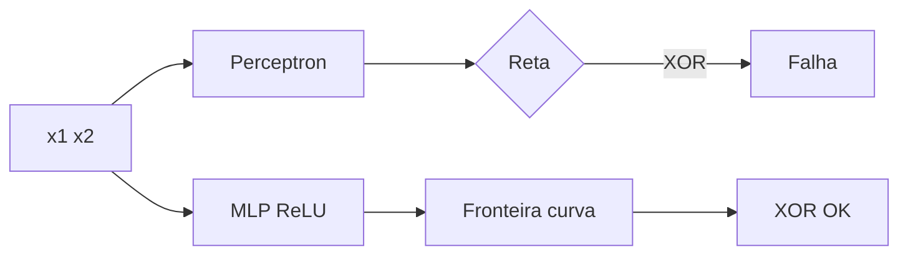

# 感知和深度学习是零的

> 任何事物都会被分开,直到一个网上学习.

**Type:** Build
**Languages:** Python
**Prerequisites:** 03-regressao-do-zero, 04-classificacao-e-avaliacao
**Time:** ~80 minutes

## 学习目标

- 实现的感知 (罗森布拉特规则) 并且证明相近/分歧
- 向前和后方向后的MLP手册
- 培训与下降梯度和比较`torch.nn.Linear`
- 视觉决策界面并解释如何看待没有XOR的错误

## 问题

对于"" (camadas) +非线性 (ReLU) 构建曲线边界,深度学习需要的方法.理解或感知是理解对重量的深度.

## 概念

感觉器:`y = sign(w·x + b)`更新:`w += lr*(y_true - y_pred)*x`现在,我们要去.

限制:只有线性分离.

子子`h=ReLU(W1 x + b1)`现在`y=sigmoid(W2 h + b2)`背部链衍生品.

其他地方`max(0,z)`梯度1是0以逆.



```figure
perceptron-vs-mlp
```

## 建立它

查看`code/main.py`检测和测试.

## 用它

```python
import torch
model = torch.nn.Sequential(torch.nn.Linear(2,8), torch.nn.ReLU(), torch.nn.Linear(8,1), torch.nn.Sigmoid())
# treino com torch.optim.SGD
```

只有MLP不需要同步,可在XOR的精度下达5%

## 运送它

`outputs/skill-perceptron.md`当使用线性与MLP,如 debugar frontiera.

## 运动

1. 发现并非相近的 XOR (证明).
2.                                                                                                                                                                                                                                                               
3. 另外,我还有一个隐藏的团队.

## 关键词

| Term | Definição |
|---|---|
| Perceptron | Classificador linear com update erro-dirigido |
| ReLU | max(0,z) |
| Backprop | Regra da cadeia para gradientes |
| XOR | Problema não-linear que exige oculta |

## 进一步阅读

- [Rosenblatt 1958 — Perceptron](https://psycnet.apa.org/record/1959-09865-001)
- [3Blue1Brown — Neural Networks](https://www.3blue1brown.com/topics/neural-networks)
- [PyTorch basics](https://pytorch.org/tutorials/beginner/basics/intro.html)
