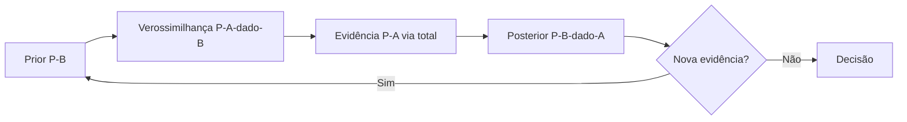

# 零的可能性:条件,总和

> 假如你有病,你会错了10倍.

**Type:** Build
**Languages:** Python
**Prerequisites:** 01-estatistica-descritiva
**Time:** ~60 minutes

## 学习目标

- 计算条件概率 P B 测试独立性与产品规则
- 应用总概率法,以分化一个互独占场景的事件
- 根据贝耶斯定理的定理来实现条件变换 (医学测试,垃圾邮件,)
- 构建一个微观投资率的分别为零,计算期望和变化

## 问题

检测到一种罕见疾病,99%的敏感度和95%的特异性.每1000人中就有一种疾病.

 误解  混 P 语 (positivo)  语 (doente) 语 (doente) 语 (doente) 语 (doente) 语 (doente) 语)  语 (falesia) 语 (falesia) 语 (falesia) 语 (falesia) 语 (falesia) 语 (falesia) 语 (falesia) 语 (falesia) 语 (falesia) 语 (falesia) 语 (falesia) 语 (falesia) 语 (falesia) 语 (falesia) 语 (falesia) 语 (falesia) 语 (falesia) 语 (falesia) 语 (falesia) 语 (falesia) 语 (falesia) 语 (falesia) 语 (falesia) 语 (falesia) 语 (falesia) 语 (falesia) 语 (falesia) 语 (falesia) 语 (falesia) 语 (falesia) 语 (falesia) 语 (falesia) 语 (falesia) 语 (语) 语 (语) 语) 语 (语) 语 (语) 语)

## 概念

### 条件性概率

```
P(A|B) = P(A ∩ B) / P(B),  com P(B) > 0
```

: "B发生的可能性" 限制宇宙发生的B事件.

例子: dado justo, B = "saiu par" {2,4,6}, A = "saiu 6". P(A 于B) = (1/6)/(3/6) = 1/3.

### 独立

独立的知识,不变得有机会:

```
P(A|B) = P(A)  <=>  P(A ∩ B) = P(A) · P(B)
```

两种货币发行:P 二号 二号 一号 = 1/2 =P 二号 独立

### 概率总数

部分空间 (互独占,共同所有):

```
P(A) = Σ P(A|Bi) · P(Bi)
```

工作单位:P                                                                                                                                                                                                                                                             

### 贝耶斯理论

换一个条件组合,作为两个公式:

```
P(B|A) = P(A|B) · P(B) / P(A)
```

医疗测试: 没有任何病例) = 0.99·0.001 / (0.99·0.001 + 0.05·0.999) ≈ 0.0194 ≈ 2%.



```figure
stats-probability-bayes
```

## 建立它

### 步骤1: 条件和独立性做零

```python
def cond_prob(p_ab, p_b):
    if p_b <= 0:
        raise ValueError("P(B) deve ser > 0")
    return p_ab / p_b

def joint_if_independent(p_a, p_b):
    return p_a * p_b

def is_independent(p_a, p_b, p_ab, tol=1e-9):
    return abs(p_ab - p_a * p_b) <= tol

print(cond_prob(1/6, 3/6))          # 0.333: P(6 | par)
print(is_independent(0.5, 0.5, 0.25))  # True: duas moedas
```

### 步骤2:概率总数

```python
def total_prob(cond_probs, priors):
    # cond_probs[i] = P(A|Bi), priors[i] = P(Bi)
    if abs(sum(priors) - 1.0) > 1e-9:
        raise ValueError("priors devem somar 1")
    return sum(c * p for c, p in zip(cond_probs, priors))

p_pos = total_prob([0.99, 0.05], [0.001, 0.999])
print(f"P(positivo) = {p_pos:.4f}")  # ~0.0509
```

### 步骤3:贝斯+PMF,希望和变化

```python
def bayes(p_a_given_b, p_b, p_a):
    return p_a_given_b * p_b / p_a

print(f"P(doente|+) = {bayes(0.99, 0.001, p_pos):.4f}")  # ~0.0194

def pmf(values, probs):
    if abs(sum(probs) - 1.0) > 1e-9:
        raise ValueError("probs devem somar 1")
    return dict(zip(values, probs))

def expected_value(d):
    return sum(x * p for x, p in d.items())

def variance_dist(d):
    mu = expected_value(d)
    return sum(((x - mu) ** 2) * p for x, p in d.items())

dado = pmf([1,2,3,4,5,6], [1/6]*6)
print(expected_value(dado), variance_dist(dado))  # 3.5, ~2.917
```

## 用它

算数和计算`fractions`染病的原因:

```python
from fractions import Fraction

# Bayes exato com frações
p = Fraction(99,100) * Fraction(1,1000) / (
    Fraction(99,100)*Fraction(1,1000) + Fraction(5,100)*Fraction(999,1000))
print(p, float(p))  # ~0.0194

# Verificação empírica por simulação (lei dos grandes números)
import random
random.seed(0)
n = 200_000
doente_pos = sum(1 for _ in range(n)
                 if random.random() < 0.001 and random.random() < 0.99)
saud_pos = sum(1 for _ in range(n)
               if random.random() >= 0.001 and random.random() < 0.05)
print(doente_pos / (doente_pos + saud_pos))  # ~0.02
```

模拟和公式应与二a house decimal com n grande一致.

## 运送它

艺术品:`outputs/skill-probabilidade.md`检查清单"每次改变条件时,先申报,并证据先结论".

## 运动

1. 垃圾邮件选是98%的垃圾邮件,2%的非垃圾邮件.`bayes()`现在,我们要去.
2. 证明P (A) 没有B (B) =P (B) 没有A) 只有当P (A) =P (B) 时才值.
3. 建立一个"两个数据的总和"和计算希望和变化`expected_value()`其他`variance_dist()`现在,我们要去.

## 关键词

| Term | O que dizem | O que realmente é |
|---|---|---|
| Condicional P(A\|B) | "chance de A se B" | P(A∩B)/P(B); restringe o universo a B |
| Independência | "sem relação" | P(A∩B)=P(A)·P(B); saber B não muda A |
| Probabilidade total | "média ponderada" | P(A)=Σ P(A\|Bi)·P(Bi) sobre partição |
| Teorema de Bayes | "inverter a pergunta" | P(B\|A)=P(A\|B)·P(B)/P(A) |
| PMF | "tabela de chances" | P(X=x) para cada valor discreto; soma 1 |
| Esperança | "média teórica" | Σ x·P(x); para onde a média amostral converge |

## 进一步阅读

- [Seeing Theory — Probability](https://seeing-theory.brown.edu/)视觉互动
- [Stat Trek: Bayes Theorem](https://stattrek.com/probability/bayes-theorem)参考例
- [Python `fractions` docs](https://docs.python.org/3/library/fractions.html) 计算生产的准确情况
