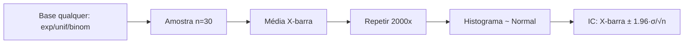

# 分布式和理论中心的限制

> 为什么30个"几乎正常"数据的平均值可以解释所有模型的信心间隔?

**Type:** Build
**Languages:** Python
**Prerequisites:** 01-estatistica-descritiva, 06-probabilidade-fundamentos
**Time:** ~60 minutes

## 学习目标

- 执行式PMF/PDF 德伯诺利,二分数,鱼类,正常和指数式使用`math`
- 提供每次分销服务`random`有效的媒体/理论变化
- 模拟定理 中央定理:一个半径相近于一个正常
- 实现零代码的比较`numpy`现在,我们要去.`statistics`当可用时

## 问题

你测量了一个API的响应速度:平均200ms,但5秒高. É "正常"吗?我可以用平均 ± 2·desvio como interval? Se una distribución base é exponencial (assimétrica),一个个体响应不是正常的  mas un medio de 30 requisiciones é.

## 概念

### 分:伯诺利 → 二进制 → 鱼类

- **Bernoulli(p):**,,,,,,,,,,,,,,,,,,,,,,,,,,,,,,,,,,,,,,,,,,,,,,,,,,,,,,,,,,,,,,,,,,,,,,,,,,,,,,,,,,,,,,,,,,,,,,,,,,,,,,,,,,,,,,,,,,,,,,,,,,,,,,,,,,,,,,,,,,,,,,,,,,,,,,,,,,,,,,,,,,,,,,,,,,,,,,,,,,,,,,,,,,,,,,,,,,,,,,,,,,,,,,,,,,,,,,,,,,,,,,,,,,
- **Binomial(n,p):**总理:`P(X=k) = C(n,k)·p^k·(1-p)^(n-k)`,,,,,,,,,,,,,,,,,,,,,,,,,,,,,,,,,,,,,,,,,,,,,,,,,,,,,,,,,,,,,,,,,,,.
- **Poisson(λ):**事件每次都很少发生.`P(X=k) = λ^k·e^-λ/k!`边界二进制当 n grande, p pequeno, np=λ.

### 连续:正常和指数

- **Normal(μ,σ):** `f(x) = e^(-(x-μ)²/2σ²)/(σ√2π)`标准规则68-95-99.7.
- **Exponencial(λ):**波森事件中的速度.`f(x) = λ·e^(-λx)`记忆: P                                                                                                                                                                                                                                                             

### 理论中心的限制 (TCL)

如果 x1..xn são i.i.d. com 中间 μ e变量 σ2 finita,则:

```
X̄ ~ Normal(μ, σ²/n)  quando n cresce
```

为任何基础 (均,指数式,二项) 为此,平均的 N≥30 个标准 A/B 测试.



```figure
stats-distribuicoes-tcl
```

## 建立它

### 步骤1: PMF/PDF做零 (仅)`math`)

```python
import math

def bernoulli_pmf(k, p):
    return p if k == 1 else (1 - p if k == 0 else 0.0)

def binom_pmf(k, n, p):
    if not 0 <= k <= n:
        return 0.0
    return math.comb(n, k) * p**k * (1-p)**(n-k)

def poisson_pmf(k, lam):
    return lam**k * math.exp(-lam) / math.factorial(k)

def normal_pdf(x, mu=0.0, sigma=1.0):
    return math.exp(-((x-mu)**2)/(2*sigma**2)) / (sigma * math.sqrt(2*math.pi))

def expon_pdf(x, lam):
    return lam * math.exp(-lam*x) if x >= 0 else 0.0

print(binom_pmf(2, 10, 0.5))   # ~0.0439 (= 45/1024)
print(poisson_pmf(3, 2.0))     # ~0.180
print(normal_pdf(0))           # ~0.399
```

### 步骤2: 射器`random`

```python
import random

def sample_bernoulli(p, rng):
    return 1 if rng.random() < p else 0

def sample_binomial(n, p, rng):
    return sum(sample_bernoulli(p, rng) for _ in range(n))

def sample_poisson(lam, rng):
    # Knuth: conta eventos até exceder e^-λ
    L = math.exp(-lam)
    k, prod = 0, 1.0
    while True:
        k += 1
        prod *= rng.random()
        if prod <= L:
            return k - 1

def sample_expon(lam, rng):
    return -math.log(1 - rng.random()) / lam  # inversa da CDF

def sample_normal(mu, sigma, rng):
    return rng.gauss(mu, sigma)  # Box-Muller interno do CPython

rng = random.Random(0)
print([sample_binomial(10, 0.5, rng) for _ in range(5)])
```

### 步骤3:模拟或TCL

```python
def sample_means(sampler, n, reps, rng):
    return [sum(sampler() for _ in range(n)) / n for _ in range(reps)]

rng = random.Random(42)
means = sample_means(lambda: rng.expovariate(1.0), n=30, reps=2000, rng=rng)
m = sum(means) / len(means)
v = sum((x-m)**2 for x in means) / len(means)
print(f"base exp(1): E[X̄]={m:.3f} (→1.0) Var={v:.4f} (→1/30≈0.0333)")
```

## 用它

会议`numpy`现在,我们要去.`statistics`(可选):

```python
try:
    import numpy as np
    rng = np.random.default_rng(0)
    s = rng.binomial(10, 0.5, size=50_000)
    print(f"[numpy] binomial(10,.5): média={s.mean():.3f} (→5.0) var={s.var():.3f} (→2.5)")
    e = rng.exponential(1.0, size=(2000, 30)).mean(axis=1)
    print(f"[numpy] TCL exp: E[X̄]={e.mean():.3f} Var={e.var():.4f}")
except ImportError:
    print("numpy não instalado — comparação pulada (pip install numpy)")
```

您的`math.comb`必须在3a家中达成一致.

## 运送它

艺术品:`outputs/skill-distribuicoes.md`指南"什么分配使用+什么时候 TCL允许正常间隔".

## 运动

1. √ 鱼 (λ=2):将其比较为PMFs k=0.5.
2. 重新模拟TCL基统一`random.random()`,我还没有说过.
3. 果:使用基础`tan(pi*(u-0.5))`由于什么? (Dica: variância infinita)

## 关键词

| Term | O que dizem | O que realmente é |
|---|---|---|
| Bernoulli | "cara ou coroa" | Bloco atômico 0/1 com prob. p |
| Binomial | "k sucessos em n" | Soma de Bernoullis; C(n,k)p^k(1-p)^(n-k) |
| Poisson | "eventos raros" | Limite da Binomial; E=Var=λ |
| Normal | "curva sino" | PDF gaussiana; 68-95-99.7 em ±1/2/3σ |
| Exponencial | "tempo de espera" | Intervalo entre Poissons; sem memória |
| TCL | "média vira normal" | X̄→Normal(μ,σ²/n); exige variância finita |

## 进一步阅读

- [Seeing Theory — Distributions & CLT](https://seeing-theory.brown.edu/)视觉互动
- [SciPy stats docs](https://docs.scipy.org/doc/scipy/reference/stats.html)生产
- [NIST: Probability Distributions](https://www.itl.nist.gov/div898/handbook/eda/section3/eda366.htm)参考
