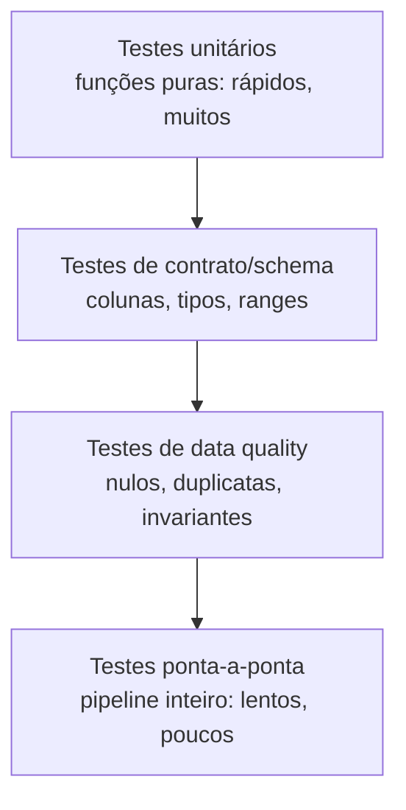

# 清洁代码和数据科学测试

> 电脑的生产过程, 的生产过程, 的生产过程, 的生产过程.

**Type:** Build
**Languages:** Python
**Prerequisites:** 01-estatistica-descritiva, 02-limpeza-e-eda
**Time:** ~60 minutes

## 学习目标

- 解释那些在生产中碎的笔记本 (estado oculto, ejecución fora de orden, dependências implícitas)
- 修复单独笔记本单元管道模块化单纯的函数和方案合同
- 应用SRP,DY和验证的数据代码
- 测试数据质量 (图案,零,范围,变量)
- 解释一个试验金字塔应用一个DS:单元快速,合同/方案,ponta-a-ponta lentos

## 问题

你交给一个笔记本,它完美地运行你的机器.`idade`像串一样来了`"32"`现在,我已经开始了.`dropna()`无声地移除40%的线条. 在生产中,工作日程在午夜时出现错误,作为有用的信息.

笔记本本的优化利用,不重复. 全球变化的状态,细胞执行的命令外的隐含类型转换或非确定性结果. O custo aparece después: retrabalho, modelo treinado con dados corrompidos, decisión errada. A saída é tratar código de datos como software: pequeñas funciones, entradas validadas, comportamiento testado.

## 概念

### 纯粹的职能:同一个入口,同一个出口

一个纯粹的功能不是全球性的,不依赖于执行顺序:

```python
# impuro: depende de global e muta o argumento
THRESHOLD = 18
def filtrar_adultos(rows):
    return [r for r in rows if r["idade"] >= THRESHOLD]  # quebra se idade for str

# puro: dependências explícitas, sem mutação
def filtrar_adultos(rows, idade_minima=18):
    return [{**r} for r in rows if int(r["idade"]) >= idade_minima]
```

实践规则: um verbo por função (`load`现在`validate`现在`clean`现在`featurize`), 管道运输 (运输) 仅在线,回归新时代.

### 解决问题 (只需在此进行检查)

- **S — Single Responsibility:** `validate_schema()`有效的`clean()`,我们永远不会在一起.
- **D — Dependency Inversion (na prática):**接收阶段是指按参数 (门,列) 确定的,而不是全球性.
- **Contrato na borda:**有效的图标标 (现有列,可转换的类型).

### 丸金字塔



基础 (单位+方案) 在每一个任务中每秒运行. 管道 (管道整体与数据实际) 没有CI/noturno. 如果基础不完整,一切错误只在生产中.

```figure
clean-code-pipeline-overview
```

## 建立它

### 步骤1: 呈现表格作为指令清单和有效方案

半:每一条线`dict`标签:`list[dict]`现在,我们要去.

```python
SCHEMA = {
    "nome": str,
    "idade": int,   # aceita "32" conversível
    "salario": float,
}

def validate_schema(rows, schema):
    errors = []
    for i, row in enumerate(rows):
        for col, tipo in schema.items():
            if col not in row:
                errors.append(f"linha {i}: coluna ausente '{col}'")
                continue
            try:
                tipo(row[col])
            except (ValueError, TypeError):
                errors.append(f"linha {i}: '{col}'={row[col]!r} não converte para {tipo.__name__}")
    return errors
```

### 步骤2:管道模块化功能

```python
def clean_rows(rows):
    out = []
    for r in rows:
        novo = {"nome": str(r["nome"]).strip(), "idade": int(r["idade"]), "salario": float(r["salario"])}
        if novo["idade"] >= 0 and novo["salario"] >= 0:
            out.append(novo)
    return out

def featurize(rows):
    return [{**r, "adulto": r["idade"] >= 18} for r in rows]

def run_pipeline(rows):
    errors = validate_schema(rows, SCHEMA)
    if errors:
        raise ValueError("schema inválido:\n" + "\n".join(errors[:5]))
    return featurize(clean_rows(rows))
```

### 步骤3:数据质量测试

```python
def check_quality(rows):
    checks = {
        "sem_nulos": all(v is not None and v != "" for r in rows for v in r.values()),
        "idades_validas": all(0 <= r["idade"] <= 120 for r in rows),
        "sem_duplicatas": len({(r["nome"], r["idade"]) for r in rows}) == len(rows),
    }
    return checks
```

每个检查都返回布鲁尔语名字:当它失败时,你知道什么是变化不变的.

## 用它

产品生产图书馆 (`pandera`计划`pytest`作为跑步者:

```python
# import pandera.pandas as pa
# import pandas as pd
# from pandera import Column, DataFrameSchema, Check
#
# schema = DataFrameSchema({
#     "nome": Column(str),
#     "idade": Column(int, Check.between(0, 120)),
#     "salario": Column(float, Check.ge(0)),
# })
# df = pd.DataFrame([{"nome": "ana", "idade": 30, "salario": 5000.0}])
# print(schema.validate(df))
# # pytest: mesmos asserts do unittest, com fixtures e mensagens melhores
```

您的验证者`pandera`必须一致: linea válida passa nos dos, linea inválida falha nos dos. 使用stdlib为理解,pandra/pytest为生产.

## 运送它

艺术品:`outputs/skill-clean-code-ds.md`任何笔记本转换的检查清单: "纯功能,图表,质量检查名单,快速检查,

## 运动

1. 布尔提议:通过`idade="trinta"`其他`salario`错误的消息在列表中?
2. 加入一个检查`salario_mediano_positivo`什么样的商业变化更值得测试?
3. 转换一个功能,改变全球的功能,变成纯粹的功能.

## 关键词

| Term | O que dizem | O que realmente é |
|---|---|---|
| Função pura | "função limpa" | Mesma entrada -> mesma saída, sem global nem mutação; testável em isolamento |
| Schema | "formato dos dados" | Contrato de colunas + tipos; validado na borda, falha rápido |
| Data quality check | "teste de dados" | Invariante nomeado (nulos, ranges, duplicatas) que explica o que quebrou |
| SRP | "uma coisa só" | Cada função/etapa tem um único motivo para mudar |
| Pirâmide de testes | "testar tudo" | Muitos testes rápidos na base (unit/schema), poucos lentos no topo (e2e) |
| Falhe rápido | "validar cedo" | Erro na entrada com mensagem útil em vez de corrupção silenciosa adiante |

## 进一步阅读

- [PEP 8 — Style Guide](https://peps.python.org/pep-0008/)官方会议
- [unittest docs](https://docs.python.org/3/library/unittest.html)跑步者
- [Pandera docs](https://pandera.readthedocs.io/) 核准生产方案
