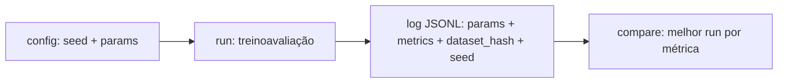

# 复制性和实验追踪

> "Funcionou ayer"不是科学结果 学习一个五种种子,版本数据集和每次运行的注册.

**Type:** Build
**Languages:** Python
**Prerequisites:** 01-estatistica-descritiva, 08-clean-code-testes-ds
**Time:** ~60 minutes

## 学习目标

- 解释为三个非确定性来源:种子未确定,数据集未登记,超值
- 固定种子`random`其他`numpy`现在,我们要去.`torch`没有使用它) 重复分断和试剂
- 版本:数据集和hash SHA-256 do conteúdo canônico
- 登记器运行 (参数 + 计量 + 数据集_hash) em JSONL com stdlib
- 比较运行的最佳选项

## 问题

报告员:一个月后,数据集更新,笔记本被编辑,没有人知道什么组合的 0.87.

没有种子固定,每一个混动/分开/抽样变化. 没有数据集,你不知道你得到了什么. 没有参数/计量记录,没有如何比较或审计. 复制性不是官僚主义:这是实验和测试之间的区别.

## 概念

### 种子:o ponto de partida do aleatório

假设的机遇是决定性的,给种子:

```python
import random
random.seed(42)
print(random.random())  # sempre 0.6394267984578837
```

固定一粒种子一旦开始 (`set_seed(42)`种子不同 = 不同的实验;因此种子也是一个标志性注册.

### 数据集版本 = 内容的化

文件名 (`dados_final_v2_REAL.csv`没有:

```
versão = sha256(representação_canônica_das_linhas)
```

两个表格与相同的内容,字节一个字节. 变化一个 vírgula, muda o hash.

### 追踪器最小化:每次运行的 JSON 线



每个运行登记`timestamp`现在`seed`现在`dataset_hash`现在`params`现在`metrics`文档仅附录:历史不可变,可用任何工具阅读.

```figure
reproducibility-tracking-overview
```

## 建立它

### 步骤1: 固定一个种子,面部分为确定性

```python
import random

def set_seed(seed):
    random.seed(seed)

def train_test_split(rows, test_ratio=0.2, seed=42):
    rng = random.Random(seed)  # instância local: não polui o global
    idx = list(range(len(rows)))
    rng.shuffle(idx)
    k = int(len(rows) * (1 - test_ratio))
    return [rows[i] for i in idx[:k]], [rows[i] for i in idx[k:]]
```

子的种子 + 子的种子 = 子的种子,永远.

### 步骤2: Hash canônico做数据集

```python
import hashlib, json

def dataset_hash(rows):
    canon = json.dumps(rows, sort_keys=True, ensure_ascii=False)
    return hashlib.sha256(canon.encode("utf-8")).hexdigest()[:12]
```

`sort_keys=True`确保关键的定律; o 12 个关键的前置只是可读的版本.

### 步骤3:追踪器 JSONL

```python
import json, datetime

def log_run(path, params, metrics, seed, dhash):
    record = {
        "timestamp": datetime.datetime.now(datetime.timezone.utc).isoformat(),
        "seed": seed, "dataset_hash": dhash,
        "params": params, "metrics": metrics,
    }
    with open(path, "a", encoding="utf-8") as f:
        f.write(json.dumps(record, ensure_ascii=False) + "\n")
    return record

def load_runs(path):
    with open(path, encoding="utf-8") as f:
        return [json.loads(line) for line in f if line.strip()]

def best_run(runs, metric="accuracy", higher=True):
    return (max if higher else min)(runs, key=lambda r: r["metrics"][metric])
```

## 用它

产量量 (`mlflow`城市`numpy`种子:

```python
# import mlflow, numpy as np
#
# np.random.seed(42)  # além de random.seed(42)
# # import torch; torch.manual_seed(42)
#
# # mlflow.start_run()
# # mlflow.log_params({"lr": 0.01, "seed": 42, "dataset_hash": "abc..."})
# # mlflow.log_metric("accuracy", 0.87)
# # mlflow.end_run()
```

您的跟踪器 JSONL e o mlflow registram o mesmo contrato:params + metrics + dataset_hash + seed.

## 运送它

艺术品:`outputs/skill-reprodutibilidade-tracking.md`检查列表: "种子固定和注册,数据集与哈希,一个 JSON 运行,最佳运行 选择 纯函数".

## 运动

1. 子`train_test_split`两次与种子42和一个与种子7.
2. 换一个数据集,重新计算 hash.`sort_keys=True`重要吗?
3. 后使用的"Logue 3"变量为"param"`best_run`公司`higher=False`没有错误的方法.

## 关键词

| Term | O que dizem | O que realmente é |
|---|---|---|
| Seed | "número mágico" | Estado inicial do gerador pseudo-aleatório; fixa toda a sequência sorteada |
| Dataset hash | "versão dos dados" | SHA-256 do conteúdo canônico; prova em quais dados você treinou |
| Run | "um treino" | Uma execução com seed + params + dataset fixos e métricas registradas |
| JSONL | "log de runs" | Um objeto JSON por linha, append-only; histórico auditável |
| Tracking | "acompanhar modelo" | Registrar params/metrics/versões para comparar e reproduzir |
| Determinismo | "sempre igual" | Mesma seed + mesmos dados + mesmo código = mesmo resultado |

## 进一步阅读

- [MLflow Tracking docs](https://mlflow.org/docs/latest/tracking.html)生产标准
- [hashlib docs](https://docs.python.org/3/library/hashlib.html) 参考
- [NumPy random seed docs](https://numpy.org/doc/stable/reference/random/index.html)种子生产
